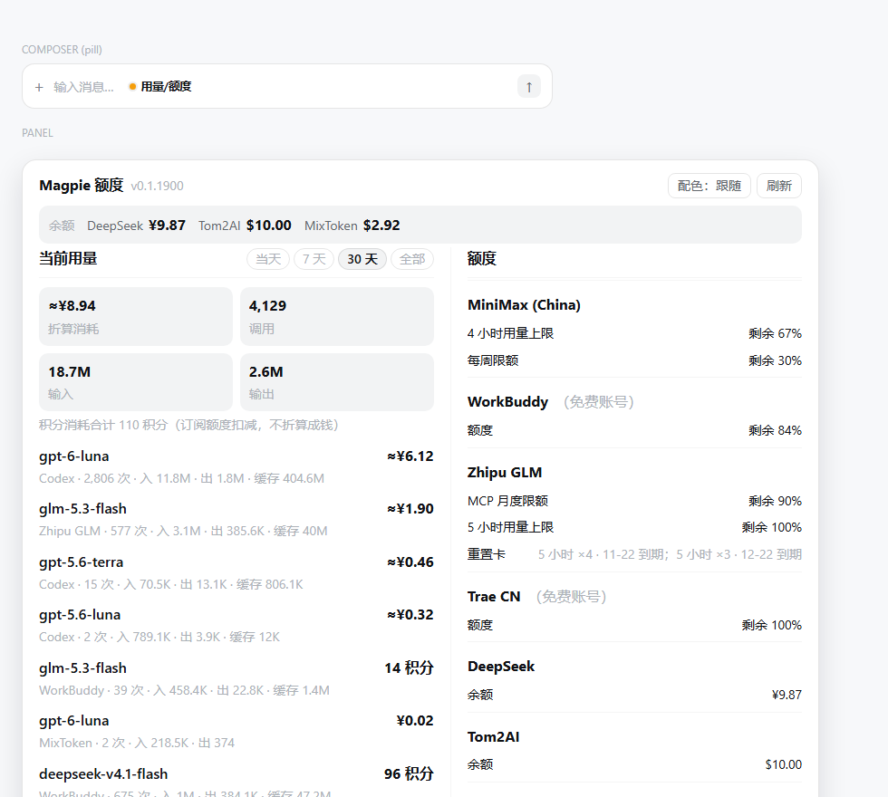
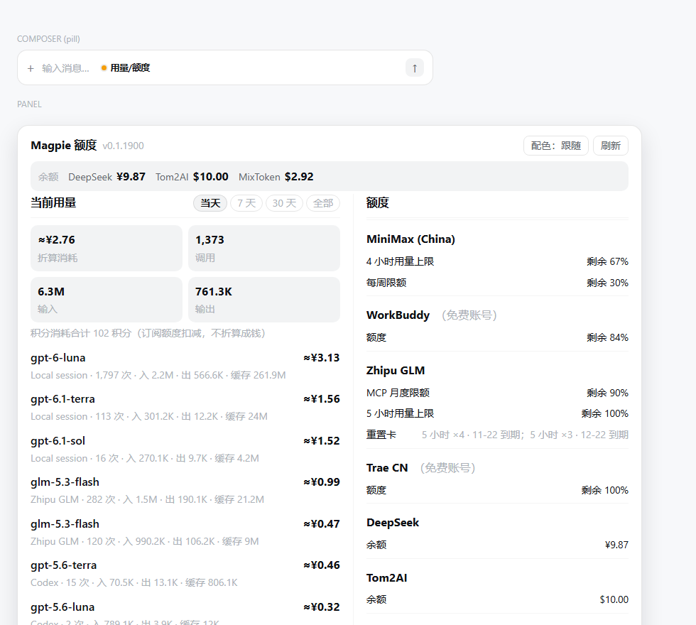

# dsh-magpie

[](https://github.com/Hongcheng-LI/dsh-magpie/actions/workflows/ci.yml)
[](LICENSE)
[](https://dshmarketplace.dev)
[](package.json)

在 DSH 输入框里一眼看到 **Magpie 全部接入账号的额度**。



Magpie 是本机的 AI 网关（托盘程序，默认 `127.0.0.1:3425`），把 WorkBuddy / Trae / MiniMax /
GLM / OpenCode Zen / Codex 等订阅账号统一成 OpenAI 兼容接口。它自带 `GET /v1/magpie/quotas`
接口，本插件直接读这个接口，所以**零配置、无需 API Key、新增账号自动出现**。

**安装**（DSH 内或终端）：

```powershell
dsh plugin --profile desktop add github:Hongcheng-LI/dsh-magpie
```

> 要求：本机运行 [Magpie](https://magpie.bot)（默认端口 3425，可用环境变量 `MAGPIE_URL` 覆盖）。
> 只改 `dsh/client.js` 时刷新页面即生效；改 `dsh/index.js` 后需重启 DSH。

## 特性一览

- 徽章 + 双栏面板：左栏用量（当天/7天/30天/全部可切换），右栏 Codex 风格额度清单
- 支持三种结算口径：订阅积分、按量估值（≈）、预充值实扣（DeepSeek 等余额账号）
- 第三方中转站（new-api / one-api 等）在 Magpie 侧配好 `balance` 探测即自动显示余额
- 窗口名自动翻译（`5 hours` → `5 小时用量上限`），重置卡按「种类 + 到期日」归组
- 免费账号自动标注（plan 含 Free 或插件内置名单）
- 读取失败的账号排在最前并给出可执行的原因（如「API key 无效（401）」）
- 配色按钮：跟随 DSH → 浅色 → 深色，偏好记忆在 localStorage
- 60s 自动刷新 + 手动刷新；主题令牌取自 DSH 自身，浅深色自适应



## 形态

- **输入框右侧徽章**：`用量/额度` —— 悬停气泡给出各账号剩余百分比与当前所选周期的花费。
- **点开面板（双栏大卡片）**：
  - **左栏「当前用量」**：Magpie `/v1/magpie/usage` 的用量汇总，标题右侧有 **`当天` / `7 天` / `30 天` / `全部`**
    分段按钮（选择记在 localStorage `magpie-quota-usage-period`，默认 30 天）。汇总给出折算消耗、
    调用次数、输入/输出 token，
    下面是按花费排序的模型用量榜。每行**第二行开头固定写来源**（`WorkBuddy · 542 次 · 入 838.7K …`），
    所以同一个模型名出现在两家账号下也分得清。结算数字按厂家真实单位显示：`84.1 积分` /
    `≈¥6.12`（挂牌价估值）/ `¥6.12`（预充值实扣），详见下文「三种计费口径」。
  - **右栏「额度」**：**逐字复刻 Codex 的额度卡**。每个账号开头就是账号名（16px 加粗），
    免费账号跟灰色 `（免费账号）` 后缀；下面平铺窗口行，标签左对齐、数值右对齐：
    ```
    MiniMax (China)
    4 小时用量上限                    剩余 95%
    每周限额                          剩余 33%

    DeepSeek（预充值）
    余额                              ¥9.99
    ```
    行本身不加粗、不上色（14px 主墨色），**没有红黄绿、没有进度条、没有账号名旁的汇总百分比**；
    plan / 账号 ID 收进账号名的悬停提示。读不了的账号写 `状态  读取失败`，下一行给出原因（红色）。
    数字只有「剩余 x%」一种口径（用量 <1% 时 `剩余 <1%`，耗尽写 `已用尽`）。原始用量
    `已用 110.88 / 800`、重置时间与倒计时（`重置 15:00（37分后）`）、「预计 x 天后耗尽」
    都收进**悬停提示**。按紧张程度排序。
  - **窗口名按 Codex 的措辞**：Magpie 原样给的 `5 hours` / `7 days` / `Credits` / `MCP · Month`
    会翻译成 `5 小时用量上限` / `每周限额` / `额度` / `MCP 月度限额`（任意 `N hours` /
    `N days` 也处理：`N 小时用量上限`、`每周限额`/`N 天用量上限`；原名保留在悬停里）。
  - **重置卡单独一行**：Magpie 的 `resets.each` 里每张卡都带窗口和到期时间，面板按
    「种类 + 到期日」归类，写成 `重置卡  5 小时 ×4 · 11-22 到期；5 小时 ×3 · 12-22 到期`，
    完全重置的写成 `完全 ×N`。悬停给出每类共几张、具体哪天到期。
- **为什么不上色、不画进度条**：Codex 的额度页只给「标签 + 剩余百分比」，不加红黄绿、
  不放汇总数——扫一眼就知道哪家要没了，其余细节按需展开。
- **观感跟随 DSH 主题**：面板底色 / 文字 / 边框 / 阴影 / 状态色全部取 DSH 自己的设计令牌
  （`--dsw-alias-*`），浅色深色自动一致。面板 860px 宽（窄屏自适应为单栏），最高 84vh，超出内部滚动。
- **字号**：标题、左栏模型名、KPI 数字 = **16px**；右栏整列（账号名、窗口名、百分比、
  重置卡）与页脚等其余小字 = **14px**。右栏账号名后免费账号会跟一个灰色 `（免费账号）`
  后缀（Magpie 数据里的 `plan`/名字含 Free 自动判定；不带的如 Trae CN 靠插件内的已知列表）。
- **配色按钮（改卡片颜色）**：面板右上角「配色：跟随」按钮循环切换 **跟随 DSH → 浅色 → 深色**，
  选择记在 `localStorage`（键 `magpie-quota-card-theme`，沿用了插件曾用名 magpie-quota，
  改名后保留此键以免清掉偏好），刷新后保持。选「浅色 / 深色」时卡片会
  在自身的 `--dsw-*` 变量上做行内覆盖，因此即使 DSH 是深色主题，卡片也能固定成浅色。
- **顶部余额条**：所有预付余额账号（DeepSeek 等）汇总成标题下的一行 `余额 DeepSeek ¥9.99`，
  不用往下滚就能看到金额。
- **预付余额账号**（`kind: "balance"`，如 DeepSeek、AIHubMix、new-api 中转站）：面板里显示
  「余额 ¥9.99」加粗大字，而不是一行空着的百分比；徽章在没有百分比窗口时会退化成
  `DeepSeek 余额 ¥9.99`。余额数值由 Magpie 格式化后原样透传（币种、单位都听 Magpie 的，
  插件不做汇率换算，也不对金额做红黄绿阈值判断）。
- 空账号（有 provider 但没有窗口也没有余额，比如纯 API key 型）：只写一行说明，不再挂
  「订阅 / 余额」标签，避免和空白数据自相矛盾。
- **读取失败的账号**：Magpie 会把探测错误挂在条目上（`error` 字段，典型是
  `401 Unauthorized: … api key: ****6b92 is invalid`）。插件把这类账号**排到最前面**，
  右上写红色「读取失败」，下面一行给出可执行的原因（如「API key 无效（401），请到 Magpie
  里更新这个账号的 Key」），完整原文放在悬停提示里——而不是显示成「未提供余额」让人以为
  这家本来就没有余额。
- 60 秒自动刷新，打开面板时若缓存超过 15s 会强制拉一次；面板底部有手动「↻ 刷新」。

## 架构

```
browser (DSH 页面，与 DSH web server 同源)
   │  fetch /magpie/quotas , /magpie/usage   ← 同源，避免 CORS（Magpie API 不带 CORS 头）
   ▼
host half  dsh/index.js             ← 注册在 DSH web server 上
   │  GET 127.0.0.1:3425/v1/magpie/quotas  (Node fetch，失败回退 subprocess+curl --noproxy)
   │  GET 127.0.0.1:3425/v1/magpie/usage   (近 30 天按模型汇总，20s 缓存)
   ▼
Magpie gateway (tray, v0.1.x)
```

- 端口覆盖：环境变量 `MAGPIE_URL`（或 `MAGPIE_BASE_URL`），例如
  `MAGPIE_URL=http://127.0.0.1:4000`。
- 缓存：quota 15s、usage 20s；同一时刻只保留一次 in-flight 请求；Magpie 离线时面板显示错误原因而不是空白。
- **改了 `dsh/index.js`（host 半边）必须重启 DSH 才生效**；只改 `dsh/client.js` 刷新页面即可。

## 让「第三方中转站 / 自定义充值」也显示余额（在 Magpie 侧配置）

插件本身只读 Magpie，因此**能不能显示某家的余额，取决于 Magpie 有没有给它配余额探测**。
Magpie 的 provider 支持这几个键（CLI 就是同一个 magpie.exe）：

| 键 | 含义 |
| --- | --- |
| `balance=<URL>` | 余额查询地址 |
| `balance.path=<表达式>` | 金额在响应里的位置，可用 `+ - * /` 和括号组合；`$` 或 `..` 前缀取带符号值；末尾 `%` 表示按 1 的比例显示成百分比 |
| `balance.method=GET\|POST` | 只回答 POST 的端点用这个 |
| `balance.token=<token>` | 余额端点要的令牌（与聊天 key 不同时用） |
| `header.X-Foo=<v>` | 附加请求头（如 new-api 的 `New-Api-User`） |

常见写法：

```powershell
# OpenAI 兼容中转站（/dashboard/billing/credit_grants、/v1/usage 之类）
magpie provider add "My Relay" url=https://relay.example.com/v1 key=sk-... `
  balance=https://relay.example.com/api/usage/token balance.path='$data.total_available / 500000'

# new-api / one-api 中转站（要 access token + 用户 id）
magpie provider set my-relay balance=https://relay.example.com/api/user/self `
  balance.path='$data.quota / 500000' balance.token=<access token> header.New-Api-User=<user id>

# 只想显示「剩百分之几」
magpie provider set my-relay balance.path='(1 - credits.monthlyCredits / 70) %'
```

配好后 Magpie 会在 `/v1/magpie/quotas` 里返回 `kind: "balance"` + `balance` 字符串，本插件自动显示，
不用改代码。若厂商根本不提供余额查询接口（部分自建/自充值平台如此），那任何工具都取不到余额，
只能退而看 Magpie 的花费统计：`GET /v1/magpie/usage`（30 天 cost / credits / 调用数）。

## 安装（本地开发形态）

```powershell
dsh plugin --profile desktop add "<本目录的绝对路径>"
# 已实测：会自动写入 dsh.profile.bundles，并把包以 link: 方式挂进 profile 的 node_modules
```

然后把 DSH 页面刷新一次（或重启 DSH）即可看到输入框右侧的徽章。

## 开发与测试

```bash
node --check dsh/index.js && node --check dsh/client.js   # 语法
node --test tests/client.test.mjs tests/host.test.mjs                                        # 15 项断言，全离线
node scripts/preview.mjs                                  # 出 preview.html，浏览器直接打开
```

两套测试都不需要 Magpie 也不需要 DSH：`tests/client.test.mjs` 用桩 `document` /
`window.__ModuleLoader__` 加载真实 `dsh/client.js`，断言徽章文案、窗口名翻译、重置卡分组、
免费账号标记、余额行、错误态与字号；`tests/host.test.mjs` 用桩内核 + 桩 `globalThis.fetch`
驱动 `dsh/index.js`，断言信任校验、quota 归一化、周期透传与降级。CI 见
`.github/workflows/ci.yml`（Node 22，语法 + 测试 + manifest 校验）。

## 自检（对着运行中的 DSH）

```powershell
# host 半边不需要登录 token。端口每次重启 DSH 都会变，取当前页面地址栏里的端口
curl.exe --noproxy '*' http://127.0.0.1:<当前端口>/magpie/quotas
```

## 离线预览（不用开 DSH 也能看样式）

```powershell
node scripts/preview.mjs [输出路径]
```

用真实 Magpie 数据渲染一个自包含的 `preview.html`（内置 CSS），浏览器直接打开即可；
Magpie 没开时渲染的是「连不上 Magpie」离线态，也值得看一眼。想看「当天」周期就改脚本里的
`usagePeriod`。

> 备注：`/v1/magpie/usage/requests` 的分页参数是 `offset`（不是 `page`，Magpie 会忽略 `page` 并重复返回第一页）；
> 行时间戳混着 `+08:00` 与 `Z` 两种写法，比较前一律 `Date.parse` 成时间戳。当日按模型榜就是靠这个逐页取到当天零点为止。

## 文件

- `dsh/index.js` —— host 半边：读 Magpie quota API，注册 `GET /magpie/quotas` 与
  `GET /magpie/usage?period=1d|7d|30d|all`（当天按模型榜走 requests 日志 offset 分页），
  15s / 20s 缓存 + 失败兜底。
- `dsh/client.js` —— 浏览器半边：`conversation.input.right` 插槽的徽章 + 弹层面板。
  - 面板挂在 `document.body` 上（`position: fixed`）。原因：输入框插槽位于一个带缩放/变换的
    composer 容器里，`fixed` 子元素会按该容器的坐标系布局，显示成半尺寸并被挤出屏幕右边缘。
- `cordis.patch.yml` —— bundle 挂载层。

## 数据形状（Magpie /v1/magpie/quotas）

```json
{ "data": [ { "provider": "workbuddy", "name": "WorkBuddy", "kind": "subscription",
  "plan": "Free plan", "user": "…", "readAt": "…",
  "windows": [ { "name": "Credits", "used": 5.65, "remaining": 94.35,
                 "resetsAt": "2026-10-31T15:59:59Z", "display": "45.22 / 800",
                 "amount": 45.22, "limit": 800, "unit": "credits",
                 "runsOutAt": "…", "runsOut": 100, "holdsWhy": "low" } ] } ] }
```

`used` 是百分比（0–100）；host 半边统一归一化成 `pct` 字段供客户端使用。

余额型账号（`kind: "balance"`，无 `windows`）：

```json
{ "provider": "deepseek", "name": "DeepSeek", "kind": "balance",
  "windows": [], "balance": "¥9.99", "readAt": "…" }
```

读取失败时 Magpie 会附上 `error`（原始报错文本），此时 `balance` 为空：

```json
{ "provider": "deepseek", "kind": "balance", "windows": [],
  "error": "401 Unauthorized: … api key: ****6b92 is invalid" }
```

## 三种计费口径（左栏数字为什么不能相加）

同一份用量日志里混着三种完全不同的结算方式，插件的做法是**按厂家真实结算单位显示、不做汇率折算**：

| 显示 | 含义 | 判定依据 |
|---|---|---|
| `78.9 积分` | 订阅/套餐扣的积分 | 该行 `credits > 0`（如 WorkBuddy、Trae） |
| `≈¥6.12` | **估值**：按官方 API 挂牌价折算「这些 token 如果在按量 API 上要花多少」，套餐用户并不会真扣这笔钱 | provider `kind` 为 `subscription` / `plan`（含未在额度列表里出现的 codex） |
| `¥6.12` | **实扣**：从预充值余额里真的扣掉的钱 | provider `kind` 为 `balance`（如 DeepSeek 预充值） |

同理左栏顶部 KPI 的「折算消耗」带 `≈`，旁边单独一行给「积分消耗合计」，两者不合并成一个数。
排序仍按 `cost → credits → calls`，所以积分型模型会排在金额型之后。

## License

MIT. See [LICENSE](LICENSE).
